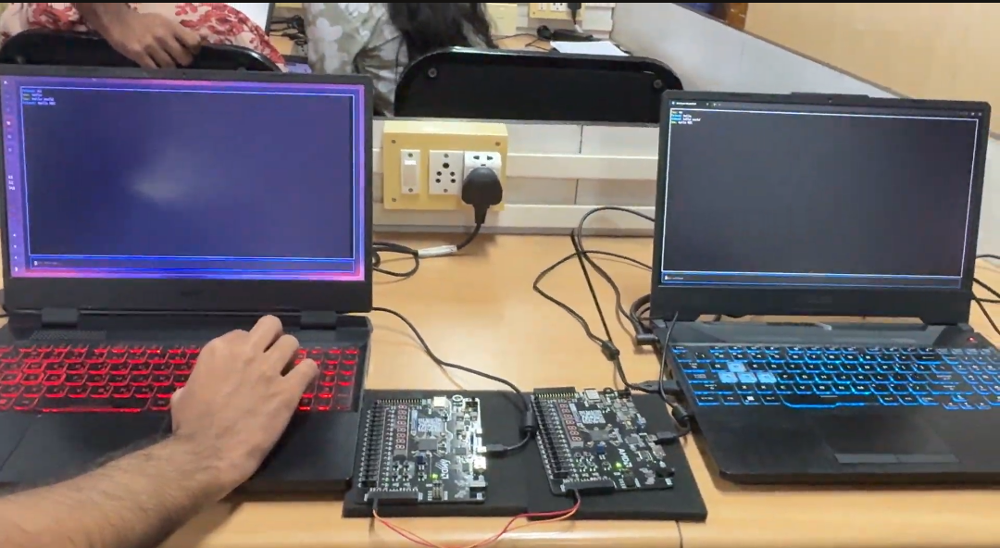

<div align="center">

# FPGA-Based Full-Duplex Chat System

**A modular UART communication system in Verilog HDL, running on two FPGA boards for real-time, two-way text chat between laptops.**




*Hardware demonstration: two laptops exchanging messages through two FPGA boards.*

</div>

---

## Table of Contents

1. [Overview](#overview)
2. [Features](#features)
3. [System Architecture](#system-architecture)
4. [Module Summary](#module-summary)
5. [Design Parameters](#design-parameters)
6. [Repository Structure](#repository-structure)
7. [Getting Started](#getting-started)
8. [Documentation](#documentation)
9. [Project Status](#project-status)
10. [Applications](#applications)
11. [Team](#team)
12. [License](#license)

---

## Overview

This project implements a full-duplex chat link between two laptops using FPGA hardware. Each laptop connects to its own FPGA board over UART, and the two boards are linked to each other with jumper wires. Messages typed on one laptop travel through both FPGAs and appear on the other, and both directions can run at the same time.

Each FPGA is built from small, single-purpose Verilog modules: a baud generator, UART transmitter and receiver, FIFO buffers, and a control FSM, all joined by a top-level module.

## Features

- UART transmit and receive with 8-N-1 framing, LSB first
- 115200 baud derived from a 100 MHz system clock
- Independent TX and RX paths for simultaneous two-way communication
- 16-entry, 8-bit FIFO buffers on both paths to avoid data loss
- Control FSM that moves data between the receive and transmit paths
- Modular RTL with a self-checking UART transmitter testbench

## System Architecture

```text
Laptop A <--> FPGA A <==== UART link (jumper wires) ====> FPGA B <--> Laptop B
```

Data path inside each FPGA:

```text
                   +-----------+
                   | BAUD GEN  |
                   +-----------+
                         |
                    baud_tick
                         |
         +---------------+---------------+
         v                               v
     +-------+                       +-------+
     |UART RX|                       |UART TX|
     +-------+                       +-------+
         |                               ^
         v                               |
    +---------+                     +---------+
    | RX FIFO |                     | TX FIFO |
    +---------+                     +---------+
         |                               ^
         +--------->+-------------+------+
                    | CONTROL FSM |
                    +-------------+
```

## Module Summary

| Module | File | Role |
|---|---|---|
| `baud_gen` | [`rtl/baud_gen.v`](rtl/baud_gen.v) | Divides the 100 MHz clock into a one-cycle baud timing pulse |
| `uart_tx` | [`rtl/uart_tx.v`](rtl/uart_tx.v) | Converts parallel bytes to a serial UART frame (start, 8 data, stop) |
| `uart_rx` | [`rtl/uart_rx.v`](rtl/uart_rx.v) | Detects the start bit, samples 8 data bits, and outputs a received byte |
| `fifo` | [`rtl/fifo.v`](rtl/fifo.v) | Synchronous 16 x 8-bit buffer with full and empty flags |
| `control_fsm` | [`rtl/control_fsm.v`](rtl/control_fsm.v) | Reads bytes from the RX FIFO and writes them to the TX FIFO |
| `top` | [`rtl/top.v`](rtl/top.v) | Instantiates and connects all modules to the FPGA I/O pins |

## Design Parameters

| Parameter | Value |
|---|---|
| FPGA board | [Real Digital Boolean](https://www.realdigital.org/hardware/boolean) |
| HDL | Verilog |
| System clock | 100 MHz |
| Baud rate | 115200 bps |
| Clock cycles per bit | 868 (100,000,000 / 115,200 = 868.055) |
| UART frame | 1 start bit, 8 data bits (LSB first), 1 stop bit |
| FIFO | 16 entries x 8 bits |
| Toolchain | Vivado |

## Repository Structure

```text
.
├── rtl/                  Verilog source for all modules
│   ├── baud_gen.v
│   ├── uart_tx.v
│   ├── uart_rx.v
│   ├── fifo.v
│   ├── control_fsm.v
│   └── top.v
├── testbench/
│   └── uart_tx_tb.v      UART transmitter testbench
├── docs/
│   ├── project-presentation.md
│   ├── interface-overview.md
│   └── specs/            Interface specification for each module
├── images/               Photos and diagrams
└── README.md
```

## Getting Started

### Run the simulation

1. Create or open a Vivado project targeting the Boolean board.
2. Add all files in `rtl/` as design sources.
3. Add `testbench/uart_tx_tb.v` as a simulation source and set `uart_tx_tb` as the simulation top.
4. Run behavioral simulation. The testbench uses a reduced clock divider so the run stays short.

### Run on hardware

1. Add a board-specific XDC constraints file that maps `clk`, `rst`, `rx` and `tx` to the correct Boolean pins. No constraints file is included yet, because the pin mapping must be checked against the board.
2. Synthesize, implement and program both FPGAs.
3. Connect FPGA A TX to FPGA B RX and FPGA B TX to FPGA A RX, with a common ground.
4. Open a serial terminal on each laptop at 115200 baud, 8-N-1, and start chatting.

## Documentation

- [Project presentation](docs/project-presentation.md)
- [Interface and architecture overview](docs/interface-overview.md)
- Module interface specifications: [baud_gen](docs/specs/baud_gen_spec.md), [uart_tx](docs/specs/uart_tx_spec.md), [uart_rx](docs/specs/uart_rx_spec.md), [fifo](docs/specs/fifo_spec.md), [control_fsm](docs/specs/control_fsm_spec.md), [top](docs/specs/top_spec.md)

## Project Status

The RTL in this repository was reconstructed from the module interface specifications, so it is not the original source. Re-run simulation and hardware tests in your own Vivado setup before relying on it.

Planned work:

- [ ] UART RX and top-level testbenches, including back-to-back bytes
- [ ] FIFO full/empty and simultaneous read/write tests
- [ ] Board-specific XDC constraints
- [ ] Simulation waveforms and test results in the repository

## Applications

- FPGA-based communication devices
- Embedded communication systems
- Hardware interface learning platforms
- Real-time digital communication demos

## Team

| Name |
|---|
| Siddharth |
| Aravind |
| Aldrin |
| Adhil |

## License

No license has been selected yet. Agree on terms with all contributors before adding one.
